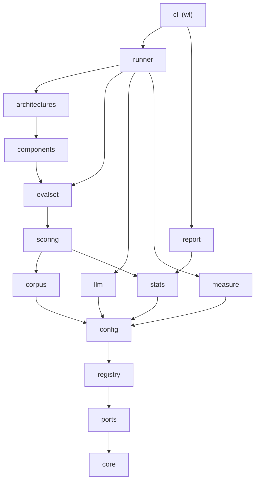
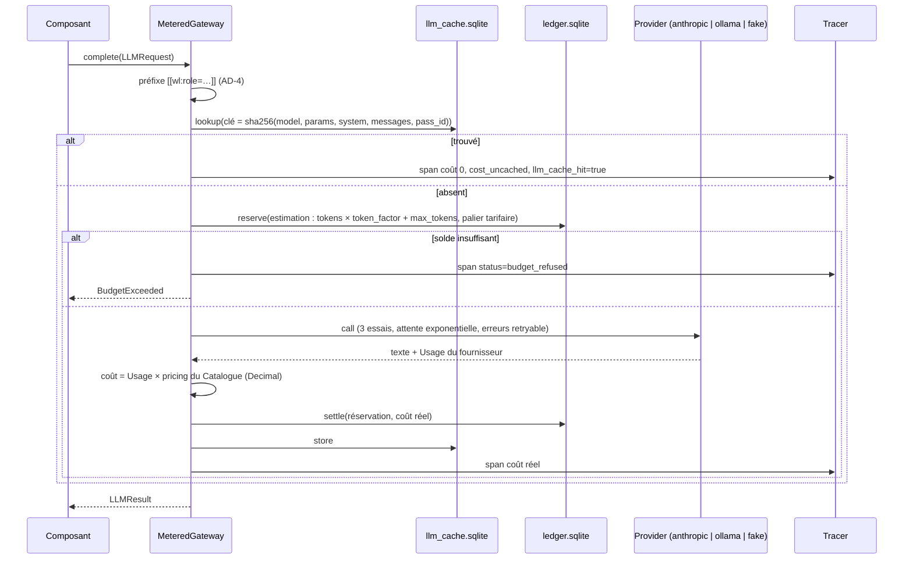

# Spine d'architecture : WaveLibrarian MVP

Les formes partagées (types, ports Python, rôles LLM, schémas YAML, fichiers d'Exécution, attributs de trace) sont dans `contracts.md` et lient au même titre que les AD. Le vocabulaire est celui du Glossaire du PRD (§3).

## Paradigme

Le banc suit le modèle **ports et adaptateurs**, avec un **registre de plugins**. Le domaine (`core`) et les ports (`ports`) ne font aucune entrée-sortie. Les Composants, les fournisseurs de modèles et les Architectures sont des adaptateurs enregistrés par nom. Le runner les assemble à partir d'une Expérience YAML et les pilote. Toute sortie d'un modèle passe par un point d'étranglement unique, la passerelle mesurée.



Une flèche signifie « peut importer ». Les couches et l'indépendance des modules frères sont listées dans AD-1.

## Invariants et règles

### AD-1 : Couches et sens des dépendances

- **Binds :** tout `src/wavelibrarian/`
- **Prevents :** une Architecture ou un Composant qui importe un SDK de fournisseur, un adaptateur concret ou le runner, ce qui casse l'interchangeabilité (FR-2) et les tests sans réseau.
- **Rule :** les couches vont de haut en bas : `cli` > `runner` | `report` > `architectures` > `components` > `evalset` > `scoring` > `corpus` > `llm` | `measure` | `stats` > `config` > `registry` > `ports` > `core`. Un module n'importe que des couches inférieures. Les modules séparés par `|` sont indépendants entre eux. Une couche qui a besoin d'un Composant (Parser pour `corpus`, Juge pour `scoring`, Generator pour `evalset`) l'obtient par `registry` ou `ctx.build`, jamais par import. Le Catalogue et les profils (schéma et chargement) vivent dans `config/`. Seuls `llm/providers/` importent `anthropic` et `httpx`. Seuls `components/embedders/` importent `sentence_transformers`. Seul `measure/` importe `opentelemetry`, `codecarbon` et `ecologits`, sauf l'adaptateur `anthropic`, qui lit les impacts EcoLogits (AD-17). Le contrat `layers` d'`import-linter` reprend cette liste mot pour mot dans `pyproject.toml` (`[tool.importlinter]`, `root_package = "wavelibrarian"`) et entre dans `COMMANDES` du contrôle rapide.

### AD-2 : Registre et construction uniforme

- **Binds :** FR-2, FR-3, UJ-4 ; tous les Composants et Architectures
- **Prevents :** deux façons de construire ou de paramétrer un Composant ; une Architecture qu'il faudrait câbler à la main dans l'orchestration.
- **Rule :** chaque classe concrète porte `@register(kind, name)`. Elle déclare un `Params` pydantic (`extra="forbid"`, `frozen=True`) et une docstring qui sert de description. Elle se construit par `cls(params, ctx)`. Un sous-Composant se construit uniquement par `ctx.build(kind, ComponentSpec)`. `registry.discover()` importe récursivement `wavelibrarian.components` et `wavelibrarian.architectures` par `pkgutil`, donc ajouter un module suffit. Un nom inconnu lève `ConfigError` avec la liste des noms du même `kind`.

### AD-3 : Passerelle mesurée, point d'étranglement unique

- **Binds :** FR-29, FR-30, FR-33, FR-34, FR-4 ; tout appel LLM
- **Prevents :** un appel payant qui échappe au plafond, au cache, à la trace ou au registre de dépense ; deux calculs de coût différents.
- **Rule :** tout appel LLM passe par `ctx.gateway` (`llm/gateway.py`, `MeteredGateway`). L'ordre ne varie pas :



Seuls `llm/gateway.py` et `llm/preflight.py` importent `llm/providers/` : un contrat `forbidden` d'`import-linter` l'impose, pour qu'aucun Composant n'appelle un provider en contournant le plafond. Les adaptateurs `llm/providers/` ne font que traduire `LLMRequest` en appel natif. `anthropic` utilise le SDK avec `cache_control` pour `cache_system` et `Message.cache`. Il lit `usage.cache_read_input_tokens` et `cache_creation_input_tokens`. `ollama` appelle `POST /api/chat` par `httpx`, avec `options` du profil (`num_gpu: 0` en CPU, `seed`) et `format` (schéma JSON) pour les sorties structurées. Le passage de `num_gpu` sur `/api/chat` est vérifié par un test `real_local`. `fake` est le Faux LLM : il ne lit que `LLMRequest.inputs` (AD-4) ; pour ses modèles, la clé du Cache de réponses inclut donc `inputs`. Les loggers `anthropic`, `httpx` et `httpcore` sont forcés à `WARNING` dans `run.log` (AD-19). Les spans des appels LLM sont émis par la passerelle seule. Ceux des embeddings et des rerankers sont émis par l'Embedder et le Reranker (un span par appel de lot). Une Architecture ou un Retriever ne tracent jamais.

### AD-4 : Rôles fermés, marqueur et sorties structurées

- **Binds :** FR-52, FR-21, FR-23 à FR-27, FR-36, FR-10, FR-12
- **Prevents :** un Faux LLM qui ne reconnaît pas un appel ; des formats de sortie inventés par chaque Composant, incompatibles avec le faux.
- **Rule :** `LLMRole` est la liste fermée de `contracts.md` §3. Le Composant appelant remplit toujours `LLMRequest.inputs` avec les clés du rôle, et le Faux LLM ne lit que ces clés, jamais le texte du prompt. Ajouter un rôle implique de modifier dans la même story `llm/roles.py` (schéma pydantic et clés d'`inputs`) et `llm/providers/fake.py` (sortie par défaut). La passerelle écrit le marqueur `[[wl:role=<role>]]` en première ligne du system, jamais un Composant. Une sortie structurée est obtenue par `complete_structured(request, Schema)`. Une sortie non conforme est réessayée une fois, puis lève `NonConformantOutput`, et la Question passe en `status: error`.

### AD-5 : Identités

- **Binds :** FR-5, FR-6, FR-9, FR-14, FR-35, FR-38, FR-53
- **Prevents :** des Citations, des métriques de recherche ou des annotations qui ne se rejoignent pas ; un Document modifié confondu avec son ancienne version.
- **Rule :** `source_path` (chemin POSIX relatif à la racine du Corpus) est l'identité logique d'un Document. `doc_id = sha256(octets)[:16]` est l'identité de sa version. `anchor_id` vaut `"<doc_id>#p<page>"` pour un PDF, `"<doc_id>#h/<slug1>/<slug2>…"` pour un texte structuré, ou `"<doc_id>#h/"` pour un texte sans titre. Les Questions citent leurs ancrages par `source_path` plus `page` ou `headings`, et `ParsedCorpus.resolve` les convertit. `passage_id`, `answer_id`, `run_id` et `config_id` suivent `contracts.md` §1. Tout hachage passe par `core/ids.py` (`canonical_json`, `sha16`).

### AD-6 : Une Architecture ne voit jamais la référence

- **Binds :** FR-14, FR-17, SM-C2
- **Prevents :** une fuite de la Réponse ou des Ancrages de référence dans une Architecture ; une Condition contexte parfait réimplémentée par chaque Architecture.
- **Rule :** `Architecture.answer` reçoit un `QuestionInput` (id, texte, langue, historique) et rien d'autre. Elle renvoie un `ArchAnswer`, que le runner seul complète en `Answer` (identifiants, condition, palier, phase, statut, latence). En Condition contexte parfait, le runner construit un Passage par Ancrage de référence (`level 0`, texte de `ParsedCorpus.anchor_text`), dans l'ordre des `reference_anchors`, et appelle `answer_with_context`. L'Architecture remplit `context_texts` à partir de `Context.blocks`. Les Juges lisent la fidélité sur ces textes, jamais sur une reconstruction. Seuls `scoring/` et `evalset/` lisent les champs de référence.

### AD-7 : Citations par étiquettes de contexte

- **Binds :** FR-18, FR-23, FR-25, FR-36
- **Prevents :** chaque Generator qui invente son format de citation ; des Citations vers des ancrages hors contexte.
- **Rule :** le `ContextBuilder` numérote les Passages `[S1]…[Sn]` et tient la table `labels` (étiquette → anchor_ids). Le Generator renvoie des étiquettes. Il les convertit en `Citation(anchor_id)` par cette table, retire celles qui n'y figurent pas et les compte dans `invalid_citations` (Answer et attribut de trace). Un nœud de résumé (RAPTOR, page de wiki) porte dès sa création les `anchor_ids` de ses feuilles.

### AD-8 : Le runner possède le Poste de coût

- **Binds :** FR-31, FR-20, FR-22, FR-25, FR-53
- **Prevents :** un même appel imputé à des postes différents selon le Composant.
- **Rule :** le runner fixe `ctx.post`, `ctx.question_id`, `ctx.condition`, `ctx.tier` et `ctx.phase` par un context manager. Le poste vaut `indexing` pendant `index` et `load`, `update` pendant `update`, `query` pendant `answer`, `judging` pendant le jugement et le Filtre closed-book, `evalset` pendant la génération de questions. Les Composants ne nomment que `step`. Le Tracer lit le poste dans le contexte. Le préchargement du CAG a lieu dans `index`, la maintenance du wiki et sa mesure de fidélité dans `index` et `update`. `judging` et `evalset` n'entrent pas dans le coût d'une Configuration.

### AD-9 : Argent, dépense et source de vérité des coûts

- **Binds :** FR-29 à FR-34, SM-4
- **Prevents :** un écart entre le coût du Rapport et la somme des Traces ; un plafond contourné par une Exécution parallèle ou une reprise.
- **Rule :** les montants sont des `Decimal` dans la devise du fournisseur, sérialisés en chaînes. Seule la passerelle calcule un coût d'appel. La même valeur part dans le span et dans le registre. `ledger.sqlite` est l'unique source du plafond. Il suit le cycle réserver, puis régler ou libérer, et la période est le mois civil UTC, par fournisseur. `traces.jsonl` est l'unique source des coûts du Rapport, et la conversion en euros a lieu seulement dans `report/`, avec le taux daté du Catalogue. Une réservation non réglée au démarrage (crash) est réglée au montant estimé.

### AD-10 : Cache d'index adressé par contenu

- **Binds :** FR-28, FR-6, FR-53, FR-24
- **Prevents :** un index servi pour une Configuration qui ne l'a pas produit ; une mise à jour qui écrase l'index d'origine.
- **Rule :** seul le runner parse, avec le `parser` de la Configuration (`auto` étant résolu en noms concrets avant le hachage). Le parsing est mis en cache par `(parser, doc_id)`. `index_key = sha16(canonical_json({corpus_fingerprint, architecture, index_key()}))`. L'implémentation par défaut de `index_key()` prend tous les Params résolus (modèles compris) moins `query_params`, plus le parser et le tokenizer. Un test de conformance vérifie que changer un paramètre hors `query_params` change la clé. `runner/index_cache.py` fait écrire l'Architecture dans `index/.tmp-<index_key>/`, ajoute `manifest.json`, puis renomme par `os.replace`. Un dossier final existe donc complet ou pas du tout. Une Architecture n'écrit que dans le dossier reçu. Après `index` ou `update`, le runner construit une instance neuve et appelle `load` (contracts.md §2.1). Une mise à jour écrit dans un nouveau dossier, avec la clé du corpus après mise à jour, et ne touche pas l'ancien.

### AD-11 : Exécution séquentielle, append-only, reprise par clés

- **Binds :** FR-4, FR-33, exigences de robustesse et de reprise
- **Prevents :** des courses sur le registre de dépense ; une reprise qui repaie ou duplique.
- **Rule :** au MVP, une Exécution tourne dans un seul processus, et le code applicatif dans un seul fil. Seuls les fils internes de codecarbon sont tolérés, et OpenTelemetry passe par `SimpleSpanProcessor`, synchrone. `WL_HOME/run.lock` interdit deux Exécutions simultanées. Les écritures SQLite se font en transactions `BEGIN IMMEDIATE`. Tout l'état d'une Exécution est dans `runs/<run_id>/` (contracts.md §5), en JSONL append-only, écrit uniquement par le runner, avec `run.log`. Après la validation et avant tout appel, un préflight vérifie qu'Ollama répond, que les modèles locaux sont présents (`/api/tags`) et que les clés d'API des modèles utilisés existent. En cas d'échec, l'Exécution sort avec le code 4. La reprise saute les clés présentes. Une erreur sur une Question donne `status: error` et l'Exécution continue. `BudgetExceeded` arrête proprement : manifeste `budget_exceeded`, Rapport partiel généré.

```mermaid
flowchart LR
    A[charger + résoudre l'Expérience] --> B[valider : schéma, registre, compatibilité, Catalogue, familles]
    B -->|erreurs| X[refus avant tout appel]
    B --> C[ingérer + profiler le Corpus]
    C --> D[check() par Configuration : inapplicable ?]
    D --> E[index ou cache, poste indexing]
    E --> F[scénario ? update, poste update]
    F --> G[answer par Question, poste query]
    G --> H[juger : auto + Panel]
    H --> I[Rapport]
```

### AD-12 : Configuration résolue, stricte et figée

- **Binds :** FR-1, FR-4, FR-9, FR-55
- **Prevents :** des valeurs par défaut divergentes cachées dans le code ; une clé mal orthographiée ignorée en silence.
- **Rule :** tout fichier YAML est chargé par `yaml.safe_load`, puis validé par un modèle de `config/schemas.py` avec `extra="forbid"`. Les erreurs sont des `ConfigError` au chemin pointé (`questions[12].reference_anchors[0].page`). La précédence va des défauts du code au profil, puis à l'Expérience. `experiment.resolved.yaml` et son `sha256` sont écrits avant tout appel. Les schémas évoluent seulement par ajout de champs optionnels. Les paramètres de coût de possession, de change et de carbone vivent seulement dans `costs.yaml` (contracts.md §4.2 bis), surchargeable par `<WL_HOME>/costs.yaml` puis par `costs:` de l'Expérience, jamais dans le code ni dans le Catalogue.

### AD-13 : Valider avant tout appel, juger l'applicabilité après profilage

- **Binds :** FR-3, FR-16, FR-22, FR-30, FR-37, FR-55
- **Prevents :** un appel payé avant un refus évitable ; une Configuration impossible traitée comme un échec.
- **Rule :** `config/validate.py` rassemble toutes les erreurs statiques et les lève en un seul `ValidationFailed`, sans réseau. Les contrôles statiques sont : noms au registre, modèles présents au Catalogue, prix des modèles d'API, dimension d'un index réutilisé, `requires_hybrid_store` contre `StoreCapabilities.hybrid`, `requires_prompt_cache` contre `prompt_cache` au Catalogue, et Panel admissible (AD-14). Les contrôles dépendants du Corpus (fenêtre, palier tarifaire au-delà de 100 000 tokens) se font dans `Architecture.check(profile)` après profilage. Ils donnent `inapplicable` et une raison dans `applicability.json` et le Rapport, jamais une exception.

### AD-14 : Panel de juges par réservoir et exclusion de famille

- **Binds :** FR-37, FR-12, FR-38, PRD §7.3
- **Prevents :** deux lectures de la règle de famille ; un Panel choisi à la main par Configuration.
- **Rule :** pour chaque Configuration, le Panel est formé des `panel_size` premiers modèles de `judges.pool`, dans l'ordre déclaré, dont la Famille diffère de celle de chaque modèle `answer_producer` de la Configuration (le Generator, selon le PRD FR-37, détecté par `config/resolve.py` via `ModelRef`) et qui ne sont pas exclus par `calibration.json`. S'il en reste moins de 2, la Configuration est refusée à la validation, sauf Juge unique calibré (v0.3.0) : `panel_size: 1` est admis si ce Juge figure, non exclu et au-dessus de `kappa_threshold` sur chaque Critère, dans le fichier `excluded_from`. Pour le Filtre closed-book, le Juge d'une question à réponse libre est le premier modèle du réservoir dont la Famille diffère de celle du modèle testé. Le verdict est la majorité, et l'égalité donne `no` et un signalement ; `na` (sans objet) l'emporte s'il est majoritaire, sinon la majorité porte sur les `yes` et `no`. `faithfulness` d'une Réponse vide ou d'une abstention vaut `na` sans Juge. `correctness` est calculé par correspondance exacte pour `answer_form: short`. `citation_correctness` et `abstention_correctness` sont toujours calculés sans Juge (`judge_model: "auto"`). Un Juge note tous ses Critères en un seul appel.

### AD-15 : Jeu d'évaluation gelé

- **Binds :** FR-9 à FR-13, FR-8
- **Prevents :** une Exécution sur un jeu modifié ; un Filtre closed-book relancé après le Gel qui invaliderait l'empreinte.
- **Rule :** l'empreinte couvre le fichier de questions sans `freeze` ni `contaminated_by` (contracts.md §4.5). `split` est attribué au Gel, stratifié par `type`, déterministe par la graine (40 % dev par défaut). Le runner refuse un fichier dont l'empreinte diffère, ou sans Gel. Il n'utilise que les statuts `validated` et `corrected`, et la partie `test` seulement si `split: test` est explicite.

### AD-16 : Tests sans réseau imposés

- **Binds :** FR-52, FR-14, SM-3, exigences de tests
- **Prevents :** un test qui télécharge un modèle ou appelle une API sans le dire ; une Architecture livrée sans passer la conformité.
- **Rule :** `pytest` tourne avec `addopts = "--disable-socket --allow-unix-socket -m 'not real_api and not real_local'"` (pytest-socket). Les marqueurs sont déclarés : `real_api` (clé `ANTHROPIC_API_KEY` requise, sinon skip, Haiku 5.5, au plus 5 Questions, plafond de l'Expérience), `real_local` (Ollama joignable et modèle présent, sinon skip) et `slow`. Les tests par défaut utilisent le profil `test` : `fake-llm-a/b/c`, `fake-embedder`, tokenizer `approx`, énergie `fake`, `WL_HOME` dans `tmp_path`. `tests/conformance/test_architectures.py` se paramètre sur **toutes** les Architectures du registre. Il vérifie l'indexation, une réponse citée valide sur une question factuelle, l'abstention sur contexte vide, la mise à jour (Document supprimé absent des Passages et des Citations), la Condition contexte parfait, des Réponses identiques avec et sans cache d'index, et une `index_key` sensible aux Params hors `query_params`. Une Architecture n'est livrée que si elle la passe. `tests/e2e/test_sm3.py` exécute `experiments/mini-test.yaml` (toutes les Architectures, profil `test`) et vérifie le Rapport complet. `tests/real/test_sm4.py` (`real_api`) vérifie que le coût tracé égale, au centime près, le recalcul depuis les tokens renvoyés et le Catalogue. La première story vérifie que `--disable-socket` fonctionne sous Windows. Le téléchargement des modèles se fait par `wl installer --profil cpu|gpu`, jamais dans un test.

### AD-17 : Traces OpenTelemetry et énergie

- **Binds :** FR-29, FR-31, FR-32
- **Prevents :** deux formats de trace ; une énergie locale comptée deux fois ou mêlée aux estimations d'API.
- **Rule :** `measure/tracing.py` utilise `opentelemetry-sdk` avec un `JsonlSpanExporter` maison, et les attributs de `contracts.md` §6. Un exporteur OTLP externe est une option de configuration, désactivée par défaut. L'énergie d'un appel à l'API Anthropic est **estimée** par EcoLogits. `measure/energy.py` appelle `EcoLogits.init(providers=["anthropic"])` au démarrage, et l'adaptateur `anthropic` lit `response.impacts` (`unknown` si le modèle est inconnu ou l'extra absent). L'énergie locale (Ollama, embedder) est relevée par phase (index, update, query d'une Configuration) avec `codecarbon.OfflineEmissionsTracker(country_iso_code=profil)`, puis répartie sur les spans de modèles locaux de la phase au prorata de leur latence. Elle est étiquetée `measured` seulement si codecarbon a lu un compteur matériel (RAPL, NVML), et `estimated` sinon. C'est le cas sous Windows sans RAPL : TDP × charge CPU. Le Rapport n'additionne jamais `measured` et `estimated`. Depuis la v0.3.0 : `mixed` quand le CPU est mesuré et la RAM estimée (affiché à part), phase `judging` pour les Juges locaux, GPU suivi seulement si le profil le demande (`energy.gpu`).

### AD-18 : Agent et navigation par protocole JSON

- **Binds :** FR-24, FR-26, FR-27 (recherche locale)
- **Prevents :** une dépendance au tool calling natif d'un fournisseur, que le Faux LLM et Ollama ne reproduisent pas de la même façon.
- **Rule :** la recherche agentique enchaîne des appels `agent_step`, dont la sortie est `{"action", "args"}`. PageIndex enchaîne des appels `select_nodes`. Les outils sont des fonctions Python en lecture seule sur le Corpus indexé (`search` en BM25, `read` par anchor_id, `list`). Les bornes (étapes, dépense par Question, nœuds lus) sont vérifiées par l'Architecture avant chaque appel. Au-delà, l'Architecture s'abstient.

### AD-19 : Secrets et données hors dépôt

- **Binds :** exigences de secrets et de dépôt public, FR-5
- **Prevents :** une clé dans une trace ou un log ; un corpus restreint ou un Rapport commité.
- **Rule :** les clés sont lues par `python-dotenv` (`.env`) puis par l'environnement, uniquement dans `llm/providers/`, et gardées en `SecretStr`. Les en-têtes et les clés ne sont jamais tracés ni journalisés. `WL_HOME` (défaut `./.wl`) et tout dossier `results` sont dans `.gitignore`. La déclaration d'un Corpus `publishable: false` échoue si son `path` est dans le dépôt sans être ignoré (`git check-ignore`).

### AD-20 : Déterminisme

- **Binds :** FR-4, FR-13, FR-39, FR-54
- **Prevents :** des résultats de recherche qui varient d'un rejeu à l'autre.
- **Rule :** tout aléa provient de `ctx.rng(*clés)` ou de `numpy.random.default_rng(int(sha16(seed, *clés), 16))`. Les appels LLM partent avec `temperature: 0` et `seed` si le fournisseur l'accepte. Les itérations portent sur des listes triées (`source_path`, ids), et les égalités de score sont départagées par id croissant.

### AD-21 : Profils d'exécution

- **Binds :** PRD §7.3, FR-37, exigence « local d'abord »
- **Prevents :** des modèles ou des options CPU et GPU codés en dur dans les Composants.
- **Rule :** trois profils sont livrés dans `defaults/profiles/` : `cpu` (défaut si l'Expérience n'en nomme pas), `gpu` et `test` (contracts.md §4.3). Le profil fournit les options Ollama, le device de l'embedder, le tokenizer, la mesure d'énergie et les modèles par défaut des rôles. Les Composants les lisent dans `ctx.profile`. Le nom du profil est écrit dans le manifeste et le Rapport.

### AD-22 : Grandeurs du Rapport calculées en un seul endroit

- **Binds :** FR-31, FR-35, FR-36, FR-39, FR-40, FR-53, FR-54
- **Prevents :** deux définitions de la Qualité, du point mort ou de la Fraîcheur ; des scores mêlant paliers, phases ou Questions contaminées.
- **Rule :** les définitions et les colonnes de `contracts.md` §7 lient. `scoring/` produit les verdicts par Question. `stats/` fournit bootstrap, McNemar, kappa et Pareto sous forme de fonctions pures. `report/` agrège, à partir des seuls fichiers de l'Exécution, par (config_id, condition, tier, phase). Les Paliers sont tirés par `corpus/tiers.py` à partir de la graine et de la liste `required_paths` (Documents des Ancrages de référence) fournie par le runner. Ces Documents appartiennent à tous les Paliers.

## Conventions de cohérence

| Sujet | Convention |
| --- | --- |
| Langue | Identifiants, clés YAML et valeurs d'énumération en anglais. Messages CLI, Rapport et docstrings en français |
| Nommage | Modules en `snake_case`, un Composant par module dans `components/<kind>s/`, une Architecture par module dans `architectures/`. Le nom au registre est égal au nom du module |
| Identifiants | `[a-z0-9-]+` pour `corpus_id`, `config_id`, `experiment_id` et `scenario_id` ; empreintes en `sha16` (16 hex) |
| Dates | ISO 8601 UTC (`2026-10-17T22:10:00Z`) ; dates de prix et de taux au format `YYYY-MM-DD` |
| Erreurs | Exceptions de `core/errors.py` uniquement ; pas de `sys.exit` hors `cli.py` ; codes de sortie CLI 0 succès, 1 erreur, 2 configuration invalide, 3 plafond atteint, 4 préflight échoué |
| Langue de la CLI | Sous-commandes et options en français (PRD §5, contracts.md §8) |
| Journalisation | `logging` standard, logger `wavelibrarian.<module>` ; pas de `print` hors `cli.py` |
| Sérialisation | `model_dump(mode="json")` ; JSONL en UTF-8, une ligne par objet, LF |
| Tests | `tests/unit/<couche>/test_<module>.py`, `tests/conformance/`, `tests/e2e/`, `tests/real/` (marqués) ; fixtures communes dans `tests/conftest.py` (`fake_ctx`, `minicorpus`, `wl_home`) |
| Prompts | Constantes en tête du module du Composant qui les utilise, au format `str.format` ; pas de moteur de gabarits |

## Pile technique

Versions relevées sur PyPI le 2026-10-17. Elles sont épinglées dans `pyproject.toml` avec `>=x.y,<x+1`, et `uv.lock` fait foi.

| Nom | Version |
| --- | --- |
| Python (uv, `uv_build`) | >=3.12 |
| pydantic | 2.14.1 |
| pyyaml | 6.0.3 |
| typer | 0.27.3 |
| anthropic | 1.15.0 |
| httpx | 0.28.1 |
| python-dotenv | 1.2.4 |
| tenacity | 9.2.1 |
| numpy | 2.5.4 |
| scipy | 1.18.1 |
| bm25s | 0.3.13 |
| networkx | 3.7 |
| markdown-it-py | 4.2.0 |
| beautifulsoup4 | 4.15.0 |
| pypdfium2 | 5.14.0 |
| opentelemetry-sdk | 1.45.1 |
| tiktoken (tokenizer de référence `o200k_base`) | 0.14.0 |
| extra `local` : sentence-transformers / torch (CPU, index `https://download.pytorch.org/whl/cpu` déclaré `explicit = true` et réservé à `torch` dans `[tool.uv.sources]`) | 6.1.0 / 2.14.1 |
| extra `energy` : codecarbon / ecologits | 3.3.1 / 0.11.3 |
| extra `docling` : docling | 2.140.0 |
| dev : pytest / pytest-socket / ruff / pyright / import-linter / fpdf2 | 9.1.1 / 0.8.1 / 0.17.1 / 1.1.414 / 2.15 / 2.8.9 |

Les tests par défaut n'exigent aucun extra. Un module qui importe un extra le fait au premier usage et lève `WlError("installer l'extra …")` s'il est absent.

## Germe structurel

```text
src/wavelibrarian/
  cli.py                 # typer, commande `wl` : corpus, questions, run, calibrer, rapport, registre, installer (contracts §8)
  core/                  # types.py, errors.py, ids.py : aucune dépendance interne
  ports/                 # components.py, architecture.py, gateway.py, measure.py, context.py (Protocols)
  registry.py            # @register, discover(), list_components()
  config/                # schemas.py, catalog.py, load.py, resolve.py (profils, ModelRef, empreinte), validate.py
  defaults/              # models.yaml, costs.yaml, profiles/{cpu,gpu,test}.yaml (données du paquet)
  llm/                   # gateway.py, roles.py, budget.py, cache.py, preflight.py
    providers/           # anthropic.py, ollama.py, fake.py
  corpus/                # declare.py, ingest.py, profile.py, entities.py, tiers.py, scenario.py
  components/            # parsers/ chunkers/ embedders/ stores/ lexical/ graph/ retrievers/
                         # rerankers/ context/ generators/ deciders/ rewriters/ judges/
  architectures/         # no_context.py … lightrag.py (un module par Architecture)
  evalset/               # io.py, check.py, generate.py, closed_book.py, freeze.py
  scoring/               # retrieval.py, answer.py (exact, citations, abstention), panel.py, calibration.py
  stats/                 # bootstrap.py, mcnemar.py, kappa.py, pareto.py
  measure/               # tracing.py, energy.py, tco.py, tokenizers.py
  runner/                # context.py, index_cache.py, execute.py, resume.py, rundir.py
  report/                # markdown.py, tables.py, export.py (front de Pareto -> Expérience, FR-41)
corpora/minicorpus/      # corpus.yaml, docs/, questions.yaml (gelé), scenario/, extras/ (sentinelle, piégé)
experiments/             # mini-test.yaml (profil test, toutes Architectures), mini-cpu.yaml, mini-real-haiku.yaml
scripts/                 # make_minicorpus_pdfs.py (fpdf2) : les PDF générés sont commités
tests/                   # unit/, conformance/, e2e/, real/
```

Environnement d'exécution : une seule machine, Windows 11 ou Linux, sans serveur ni conteneur au MVP. Ollama local (`http://localhost:11434`) et API Anthropic par `.env` sont les seuls services externes. L'état local vit dans `WL_HOME`.

Ordre de construction imposé par les dépendances : `core` et `ports`, puis `registry` et `config`, puis `llm` avec le Faux LLM et `measure/tracing`, puis `corpus` et le Mini-corpus, puis `runner`, `scoring`, `stats` et `report` avec les Baselines, enfin les Architectures, en parallèle et dans l'ordre du PRD §7.1. La suite de conformité existe avant la première Architecture du niveau 1.

## Correspondance capacités → architecture

| Capacité | Lieu | Règles |
| --- | --- | --- |
| FR-1, FR-4 Expérience, reproductibilité | `config/`, `runner/` | AD-12, AD-11, AD-20 |
| FR-2, FR-3 Registre, compatibilité | `registry.py`, `config/validate.py` | AD-2, AD-13 |
| FR-5 à FR-7 Corpus, ingestion, profil | `corpus/`, `components/parsers/` | AD-5, AD-10, AD-19 |
| FR-8 Mini-corpus | `corpora/minicorpus/`, `scripts/` | AD-15, AD-16 |
| FR-9 à FR-13 Jeu d'évaluation | `evalset/` | AD-15, AD-5, AD-14 |
| FR-14 à FR-17 Contrat, abstention, Baselines, contexte parfait | `ports/architecture.py`, `architectures/`, `runner/` | AD-6, AD-7, AD-13, AD-16 |
| FR-18 à FR-27 Architectures du niveau 1 | `architectures/`, `components/` | AD-2, AD-7, AD-10, AD-18 |
| FR-28 Cache d'index | `runner/index_cache.py` | AD-10 |
| FR-29 à FR-34 Traces, FinOps, plafond, cache LLM | `llm/`, `measure/` | AD-3, AD-8, AD-9, AD-17 |
| FR-35 à FR-39 Métriques, Panel, calibration, statistiques | `scoring/`, `stats/` | AD-14, AD-6 |
| FR-40, FR-41 Rapport, export du front | `report/` | AD-9, AD-17, AD-22 |
| FR-52 Composants factices | `llm/providers/fake.py`, `components/embedders/fake.py` | AD-4, AD-16 |
| FR-53, FR-54 Scénario, paliers | `corpus/scenario.py`, `corpus/tiers.py` | AD-5, AD-10, AD-20 |
| FR-55 Catalogue | `defaults/models.yaml`, `config/catalog.py` | AD-13, AD-14 |

## Différé

- **LiteLLM** comme passerelle multi-fournisseurs : il entrera comme adaptateur de `llm/providers/`, version épinglée avec empreinte, au branchement d'Azure AI Foundry ou de Bedrock.
- **Bases vectorielles** sqlite-vec, LanceDB, pgvector, Qdrant : sous-plan de la phase 3 (FR-42). `numpy_exact` en reste la référence.
- **Bases de graphes dédiées** : `networkx` suffit au MVP.
- **NER par spaCy** : heuristique hors ligne au MVP (séquences capitalisées), plus fine quand la densité de liens servira à trancher une hypothèse.
- **Parallélisme et API batch** : à prévoir quand la durée des Exécutions sur les corpus réels l'exigera. Le registre de dépense est déjà en transactions SQLite `BEGIN IMMEDIATE` (AD-11).
- **Exporteurs de traces externes** (Langfuse, Phoenix) : Composants comparés (FR-45).
- **Optimiseur Optuna** (FR-48), **mode mission**, **MCP**, **fiche conformité-sécurité**, **profils de déploiement** et **infrastructure** (conteneurs, OpenTofu, Azure) : hors MVP, à décider à leur phase.
- **Graphiques** des fronts de Pareto : au MVP, le Rapport en donne des tableaux Markdown et CSV.
- **Volatilité calculée** : déclarée au MVP (FR-7).

## Points à vérifier

- Tags Ollama confirmés par `ollama list` le 2026-10-17 : `minicpm5:1b-q4_k_m`, `minicpm5:2b-q4_k_m`, `granite4.2:3b`, et pour le profil GPU `qwen3.5:4b`, `ministral-3:8b`. `wl installer --profil cpu|gpu` revérifie leur présence.
- Tarifs et limites de Claude Haiku 5.5 relevés le 2026-10-17 sur la documentation Anthropic (contracts.md §4.2) : fenêtre de 1 M tokens, 128 000 tokens en sortie, prix multipliés par 5 au-delà de 100 000 tokens de prompt, préfixe minimal de cache de 512 tokens. Le tokenizer compte environ 30 % de tokens de plus que celui de Haiku 4.5 : le Catalogue porte `token_factor: 1.5` pour l'estimation avant appel. Le Mini-corpus reste sous 60 000 tokens de référence, soit environ 90 000 tokens Haiku estimés, sous le palier.
- Taux de change (BCE, 2026-10-13), prix du kWh (TRV EDF, 2026-08-01) et intensité carbone (RTE, bilan 2025) relevés. Les hypothèses sur le PC de référence (1 200 €, 20 000 h, 0,02 €/Go/mois) ont été validées par Anaël le 2026-10-17. Elles se changent dans `<WL_HOME>/costs.yaml`, sans toucher au code (contracts.md §4.2 bis).
